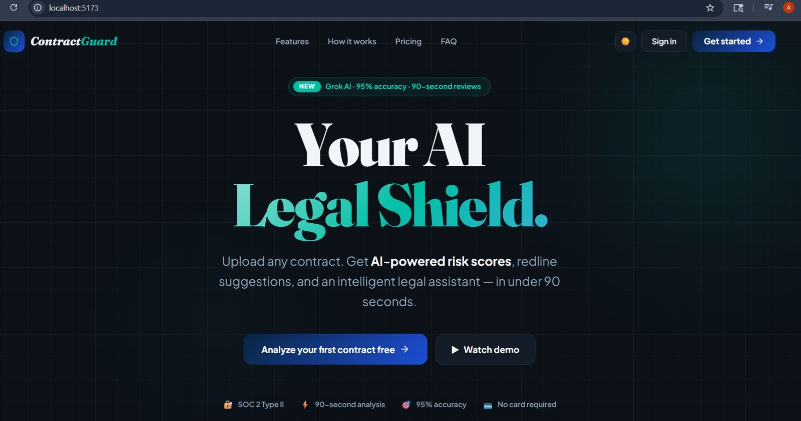

# ContractGuard Pro

AI-assisted contract review platform. Upload a PDF or DOCX contract and get structured risk analysis, a plain-language summary, AI chat about the document, and suggested redlines.

This is a showcase repository. The source code lives in a private repository. This page documents what the product does, how it is designed, and what I learned building it. Happy to walk through the code or a live demo on request.

ContractGuard Pro is an educational and productivity tool. AI output can be incorrect or incomplete and is not legal advice. Contracts should always be reviewed by a qualified legal professional.

[LinkedIn](https://www.linkedin.com/in/ratnesh-pathak-087466279/) | [Email](mailto:pathakratnesh03@gmail.com)

## Preview



## The Problem

Contracts are long, technical and hard to review quickly. Finding risky clauses, unusual obligations and missing protections means reading every page, and unfamiliar legal language makes it harder. ContractGuard Pro explores how an LLM can speed up that first pass by turning a raw document into organized, reviewable insights, while keeping a human in the loop.

## What It Does

| Area | Capability |
| --- | --- |
| Document extraction | Text extraction from PDF and DOCX files, with normalization before analysis |
| Risk analysis | LLM-powered review that surfaces potentially unfavorable clauses, financial exposure, termination and liability language, and missing protections |
| Contract summary | A dedicated summary workflow for the key points of a long agreement |
| AI contract chat | Ask questions about an analyzed contract, such as "What happens if I terminate early?" |
| Redlines | Suggested directions for changing problematic language, intended for human review |
| Workspace UI | Dashboard, upload, contract viewer, analytics, policy playbook and settings pages |

## How It Works

```
Contract file (PDF / DOCX)
  -> Document extraction and text normalization
  -> Express API
  -> Groq LLM analysis layer
  -> Risks, summary, redlines and chat answers
  -> React frontend (dashboard, viewer, analytics, chat)
```

## Tech Stack

- **Frontend:** React, TypeScript, Vite, Tailwind CSS
- **Backend:** Node.js, Express
- **AI:** Groq LLM API
- **Document processing:** PDF and DOCX text extraction
- **Security:** Helmet, API rate limiting, strict CORS, environment-based secrets

## Engineering Highlights

- Separate frontend and backend, with backend routes split by workflow (analysis, chat, redlines, summary)
- Security treated as part of the setup: secrets kept out of source control, Helmet headers, rate limiting and an explicit CORS allow-list
- Health diagnostics report whether the API key is configured without ever exposing it
- Reusable frontend components and context providers instead of one monolithic screen
- AI positioned as an assistant for review, not an authority, with limitations documented openly

## Known Limitations

- AI output can be wrong or incomplete, and legal interpretation depends on jurisdiction and context
- Generated redlines need human review before any real use
- Contract storage and persistence are limited compared with a production service
- Authentication and integrations would need more hardening for production
- This is an applied AI and software engineering project, not a certified legal product

## Roadmap

- [ ] Persistent contract database and document storage
- [ ] OCR for scanned PDFs
- [ ] Clause-by-clause comparison and version history
- [ ] Jurisdiction-aware analysis
- [ ] Automated testing and CI/CD
- [ ] Secure cloud deployment

## Author

Ratnesh Pathak - M.Sc. Information Technology, AI / ML Engineer, Founder of Team Ignites

GitHub: [@RatneshPathak](https://github.com/RatneshPathak) | LinkedIn: [Ratnesh Pathak](https://www.linkedin.com/in/ratnesh-pathak-087466279/) | Email: pathakratnesh03@gmail.com

(c) Ratnesh Pathak. All rights reserved. The text and images in this repository may not be reused without permission.
